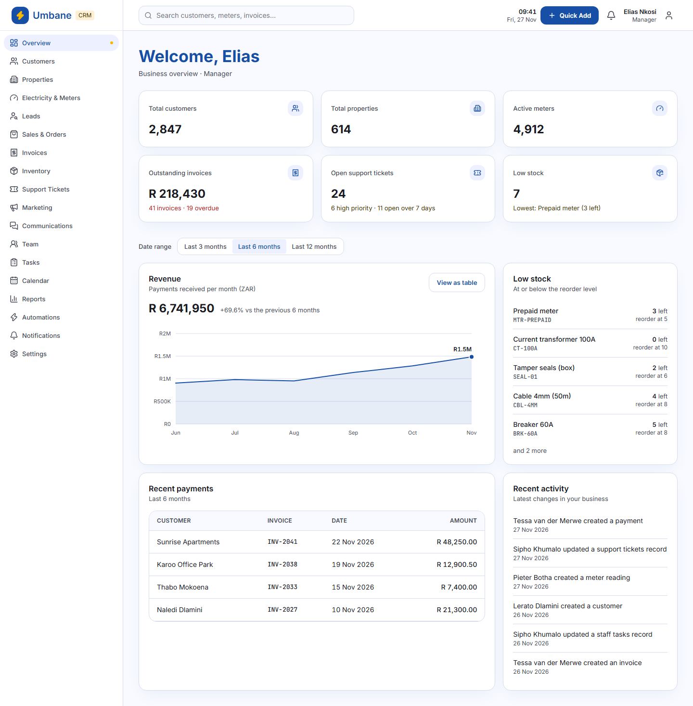
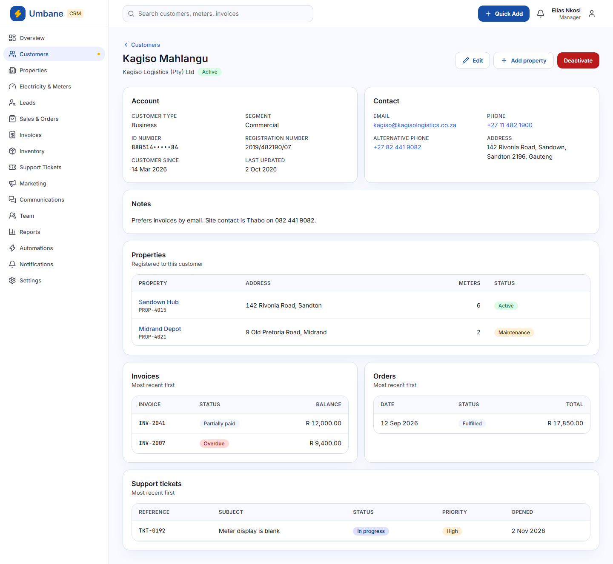
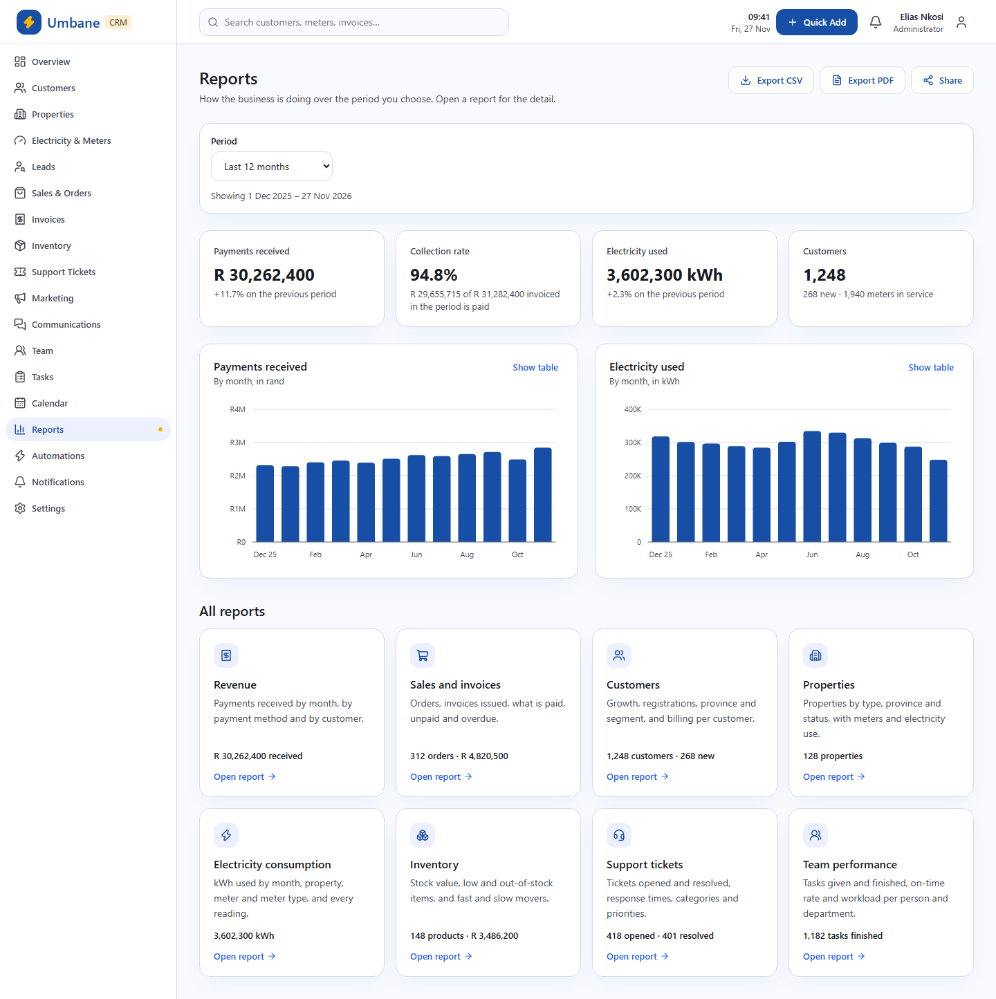

# Umbane CRM

[](https://github.com/eliasmtisie4321/UMBANE2026/actions/workflows/ci.yml)

**Bringing customers, properties and business operations together.** A CRM for South African
businesses that manage electricity metering for residential, commercial and industrial properties:
customers and properties, meters and readings, sales, invoices and payments, stock, support tickets,
team work, communication on every channel, and reports, in one place.

**Live:** https://umbane2026.vercel.app



## Features

| Area                          | What it does                                                                                                                                     |
| ----------------------------- | ------------------------------------------------------------------------------------------------------------------------------------------------ |
| Customers and properties      | Individual and business customers, properties, consent (email, SMS, WhatsApp, marketing), POPIA erasure on request                               |
| Electricity and meters        | Meters per property, readings with unusual-use flags, consumption, maintenance, replacement and retirement                                       |
| Leads, sales and orders       | Lead pipeline, conversion to customers, orders that take stock when fulfilled                                                                    |
| Invoices and payments         | Numbered tax invoices with VAT, PDF, part payments, overdue tracking                                                                             |
| Inventory                     | Products, stock movements, low-stock alerts                                                                                                      |
| Support tickets               | Customer portal, assignment, status history, attachments, internal notes                                                                         |
| Team and tasks                | Employees and access levels, invitations by email, tasks with proof of work                                                                      |
| Calendar                      | Appointments, task due dates, maintenance and invoice due dates by month or as an agenda; each person's own Google Calendar                      |
| Communications                | One history for email, SMS, WhatsApp and social posts, templates, delivery reports, retries                                                      |
| Integrations                  | Settings → Integrations: Resend, Gmail / Google Workspace, Outlook / Microsoft 365, Twilio SMS, WhatsApp Business, Facebook, Instagram, LinkedIn |
| Sharing                       | One Share dialog everywhere: several platforms at once, preview, delivery status                                                                 |
| Marketing                     | Public posts to the business's social pages                                                                                                      |
| Reports                       | Overview, customers, properties, electricity, sales, revenue, inventory, support, team; CSV and PDF                                              |
| Notifications and automations | In-app and email notifications; overdue-invoice, task and maintenance reminders                                                                  |
| Settings and audit            | Business profile, invoice and tax settings, categories, roles, audit log, data retention                                                         |
| Search and Quick Add          | Search every record the person may see from the top bar; Quick Add opens the create pages their role allows                                      |

Four roles: administrator, manager, staff and client, each limited by the database itself
(`docs/PERMISSIONS.md`).

## Screenshots

|                                                                |                                                         |
| -------------------------------------------------------------- | ------------------------------------------------------- |
|  |          |
|                        |  |

More in [`docs/screenshots/`](docs/screenshots/). The designs the screens follow (Google Stitch) are in
[`docs/designs/`](docs/designs/).

## How it is built

React 19, TypeScript, Vite and Tailwind CSS in the browser; Supabase (Postgres with row security on
every table, Auth, Storage) as the system of record; Vercel for hosting, server functions and the
daily cron. The browser only has the public anon key; secrets live in Vercel and are used by the
server functions only. See [`docs/ARCHITECTURE.md`](docs/ARCHITECTURE.md) for the diagram.

## Getting access

There are no public demo logins. People join by:

- **Create account** on the sign-in page: sends an access request that a manager approves, or
- an **invitation** from an administrator (Team → Add Employee), which arrives by email.

## Running it locally

Requirements: Node.js 22.12+ (`.nvmrc`).

```bash
npm ci
cp .env.example .env   # public Supabase values only
npm run dev            # http://localhost:5173
```

`.env` only ever holds `VITE_SUPABASE_URL` and `VITE_SUPABASE_ANON_KEY` (public). The server
functions in `api/` need their own settings (service-role key, provider keys); they run on Vercel,
or locally with `vercel dev`. Every setting is listed in [`docs/ENVIRONMENT.md`](docs/ENVIRONMENT.md)
and [`docs/LAUNCH.md`](docs/LAUNCH.md). Never commit secrets or Supabase service-role keys.

## Commands

| Command                           | What it does                                                                                            |
| --------------------------------- | ------------------------------------------------------------------------------------------------------- |
| `npm run dev`                     | Development server                                                                                      |
| `npm run lint`                    | ESLint                                                                                                  |
| `npm run format` / `format:check` | Prettier                                                                                                |
| `npm run typecheck`               | TypeScript (app, server, end-to-end)                                                                    |
| `npm test`                        | Unit, screen and server tests (Vitest)                                                                  |
| `npm run test:db`                 | Every migration on an in-memory Postgres, then the row-security and rules tests                         |
| `npm run test:e2e`                | Playwright on the built app: journeys, layouts, accessibility (`npx playwright install chromium` first) |
| `npm run build`                   | Production build                                                                                        |
| `npm run verify:prod`             | Read-only check of the live site, server functions and database                                         |

## Documentation

| Topic                          |                                                                                                                                                                                                                                                                                                                                       |
| ------------------------------ | ------------------------------------------------------------------------------------------------------------------------------------------------------------------------------------------------------------------------------------------------------------------------------------------------------------------------------------- |
| Architecture                   | [`docs/ARCHITECTURE.md`](docs/ARCHITECTURE.md)                                                                                                                                                                                                                                                                                        |
| Launch, operations, backups    | [`docs/LAUNCH.md`](docs/LAUNCH.md)                                                                                                                                                                                                                                                                                                    |
| Release notes and test results | [`docs/RELEASE.md`](docs/RELEASE.md)                                                                                                                                                                                                                                                                                                  |
| Settings and migrations        | [`docs/ENVIRONMENT.md`](docs/ENVIRONMENT.md)                                                                                                                                                                                                                                                                                          |
| Roles and permissions          | [`docs/PERMISSIONS.md`](docs/PERMISSIONS.md)                                                                                                                                                                                                                                                                                          |
| Testing, security, performance | [`docs/QA.md`](docs/QA.md)                                                                                                                                                                                                                                                                                                            |
| Integrations and sharing       | [`docs/INTEGRATIONS.md`](docs/INTEGRATIONS.md)                                                                                                                                                                                                                                                                                        |
| Modules                        | [`METERS`](docs/METERS.md) · [`SALES`](docs/SALES.md) · [`INVOICES`](docs/INVOICES.md) · [`INVENTORY`](docs/INVENTORY.md) · [`SUPPORT`](docs/SUPPORT.md) · [`TEAM`](docs/TEAM.md) · [`COMMUNICATIONS`](docs/COMMUNICATIONS.md) · [`REPORTS`](docs/REPORTS.md) · [`AUTOMATIONS`](docs/AUTOMATIONS.md) · [`SETTINGS`](docs/SETTINGS.md) |
| Conventions                    | [`docs/CONVENTIONS.md`](docs/CONVENTIONS.md)                                                                                                                                                                                                                                                                                          |
| Plan                           | [`IMPLEMENTATION-v1.1.md`](IMPLEMENTATION-v1.1.md) · [`BUSINESS.md`](BUSINESS.md)                                                                                                                                                                                                                                                     |

## Known issues and limitations

- **Providers need their own approval** before they can be connected: Google (Gmail send and
  Calendar events scopes), Microsoft, Meta (App Review, WhatsApp business verification and
  templates), LinkedIn, Twilio.
  Until then each shows as not connected. Email works through the built-in Resend sender.
- **WhatsApp** free text and documents only go within 24 hours of the customer's last message;
  otherwise an approved template is needed.
- **TikTok**, **direct messages on Facebook, Instagram or LinkedIn**, and **LinkedIn company pages**
  are not supported by those providers' APIs for this use.
- **Retries** run when someone sends, while someone is signed in, and once a day (Vercel's free plan
  allows one cron a day).
- **Password-reset emails** come from Supabase; set custom SMTP for reliable delivery
  (`docs/LAUNCH.md`).
- **Storage files** are not in Supabase's database backups; download them periodically.
- Everything else known is in [`docs/RELEASE.md`](docs/RELEASE.md).

## Troubleshooting

- **Windows:** if `npm test` fails with `Cannot read properties of undefined (reading 'config')`,
  your shell's working directory uses a lowercase drive letter (`c:\...`). Run the tests from a
  shell opened at `C:\...` (uppercase). This does not affect CI.
