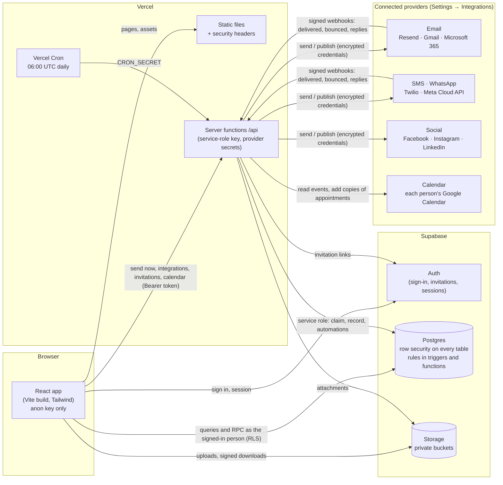
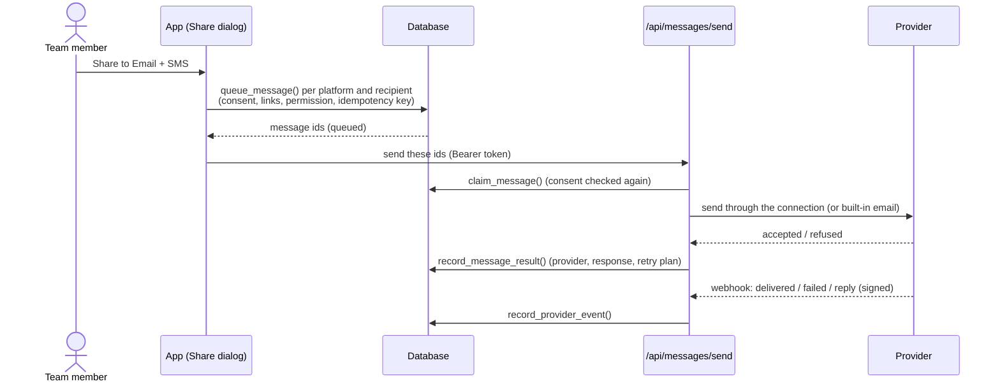

# Architecture

Umbane CRM is a single-page React app, a Supabase project (Postgres, Auth, Storage) and a set of
small Vercel functions. The database holds the business rules: every table has row security, and
anything that must be checked (money, stock, consent, roles) is enforced there, so the app and the
server functions cannot get it wrong.

## The pieces

- **The browser** only ever has the public Supabase URL and anon key. Everything it reads or writes
  goes through row security as the signed-in person.
- **Vercel functions** (`api/`) hold the service-role key and every provider secret. They do what the
  browser must not: claim and send queued messages, record delivery reports, run automations, connect
  integrations, make invitation links, read and write each person's Google Calendar. Each checks
  who is calling (a signed-in staff member, an administrator, the cron secret, or a provider
  signature) before doing anything.
- **Supabase** is the system of record and the identity system. Migrations in
  `supabase/migrations/` are applied in filename order; `scripts/db-test.mjs` runs them all on an
  in-memory Postgres in CI with the row-security tests.

## Who can do what

| Role          | Sees                                               | Changes                                                                         |
| ------------- | -------------------------------------------------- | ------------------------------------------------------------------------------- |
| Administrator | Everything in the business                         | Everything, including settings, users, integrations, audit log and data erasure |
| Manager       | Everything except audit log and privacy tools      | Customers, money, stock, tasks, reports, marketing posts, categories            |
| Staff         | Daily work                                         | Customers, readings, tickets and tasks assigned to them, sending messages       |
| Client        | Their own properties, meters, invoices and tickets | Opens support tickets                                                           |

The full matrix is `docs/PERMISSIONS.md`. The app hides what a role cannot use
(`src/auth/permissions.ts`), but the database is what enforces it.

## How a message goes out

Retries: temporary failures are tried again after 1, 5, 15 and 60 minutes (by the next send, the app
while someone is signed in, and the daily cron), but only when that cannot send twice. Details:
`docs/COMMUNICATIONS.md` and `docs/INTEGRATIONS.md`.

## Where things live

| Folder                 | What                                                                                                                                                           |
| ---------------------- | -------------------------------------------------------------------------------------------------------------------------------------------------------------- |
| `src/`                 | The React app: `screens/` (one per page, loaded on demand), `components/`, `services/` (every database and server call, returning `Result`), `auth/`, `utils/` |
| `shared/`              | Code used by both the app and the server (the provider registry)                                                                                               |
| `api/`                 | Vercel functions; `api/_lib/` shared server code and provider adapters                                                                                         |
| `supabase/migrations/` | The database: tables, row security, rules, functions, in order                                                                                                 |
| `supabase/tests/`      | Row-security and rules tests (`npm run test:db`)                                                                                                               |
| `e2e/`                 | Playwright tests on the built app with a stand-in backend                                                                                                      |
| `scripts/`             | Database test runner and the production check (`npm run verify:prod`)                                                                                          |
| `docs/`                | How each part works and how to run it                                                                                                                          |

## Quality gates

Every pull request runs, in GitHub Actions: lint, type checks (app, server, end-to-end), unit and
screen tests, the database tests, the production build, and the end-to-end tests (journeys,
layouts at three sizes, axe accessibility). After a deploy, `npm run verify:prod` checks the live
site read-only. See `docs/QA.md`.
